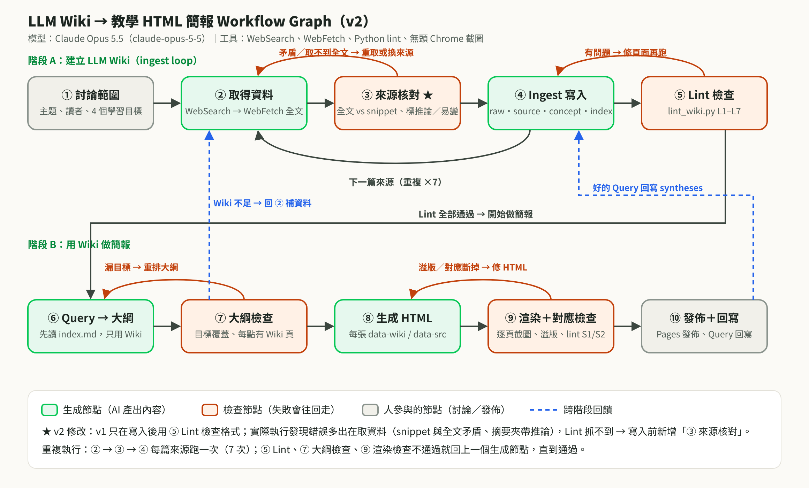
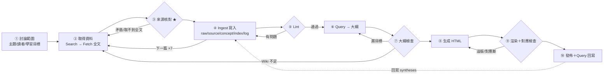

# Loop / Graph 設計說明

> 使用模型：**Claude Opus 5.5（claude-opus-5-5）**，在 Claude App 中以「先討論、後生成」方式執行。
> 工具：WebSearch（找資料）、WebFetch（取全文）、Python（`scripts/lint_wiki.py`）、無頭 Chrome（逐頁截圖）。

## 流程（文字版）

| 節點 | 做什麼 | 輸出 | 誰 |
|---|---|---|---|
| ① 討論範圍 | 決定主題、讀者、4 個學習目標 | `docs/discussion.md` | 人＋AI |
| ② 取得資料 | WebSearch 找候選 → WebFetch 取全文 | 擷取筆記 | AI |
| ③ 來源核對 ★ | 全文 vs 搜尋 snippet 對照；標【推論】【易變】；取不到全文標「部分」 | log 的 CHECK／CONFLICT | AI |
| ④ Ingest | 寫 `raw/`、`sources/`、更新 `concepts/`、`index.md`、`log.md` | Wiki 頁 | AI |
| ⑤ Lint | `lint_wiki.py` L1–L7：frontmatter、來源存在、斷鏈、孤兒頁、index 完整 | lint 報告 | 腳本 |
| ⑥ Query → 大綱 | 先讀 index.md，只用 Wiki 內容排 19 張大綱 | `workflow/outline.md` | AI |
| ⑦ 大綱檢查 | 4 個目標都覆蓋？每張都有 Wiki 頁？8 段教學結構都有？ | outline 勾選表 | AI＋人 |
| ⑧ 生成 HTML | 依 CLAUDE.md 第 5 節產生，每張帶 `data-wiki`、`data-src` | `index.html` | AI |
| ⑨ 渲染＋對應檢查 | 無頭 Chrome 逐頁截圖、偵測溢版與 JS 錯誤；lint S1/S2 檢查簡報↔Wiki 對應 | 截圖、報告 | 腳本＋AI 看圖 |
| ⑩ 發佈＋回寫 | 推上 GitHub Pages；好的 Query 回寫成 `syntheses/` | 網址 | 人 |

## 哪些步驟會重複執行？
1. **Ingest loop**：② → ③ → ④ 每篇來源跑一次，本次共 **7 次**（S01–S07）。
2. **Lint loop**：⑤ 失敗就回 ④ 修，再跑，直到全部通過（本次跑了 4 次）。
3. **Render loop**：⑨ 發現版面問題就回 ⑧ 修，再截圖（本次 3 輪）。
4. **Query 回寫**：⑥ 中產生的好答案存回 Wiki（本次 3 頁 synthesis），下次做簡報可以直接用，知識會「複利」。

## 哪些地方需要檢查或重新生成？
| 檢查點 | 失敗時回到哪 | 為什麼放這裡 |
|---|---|---|
| ③ 來源核對 | ② 重取全文或換來源 | 錯誤資訊一旦寫進 Wiki，會被所有簡報引用，越早擋越便宜 |
| ⑤ Lint | ④ 修頁面 | 結構錯誤（斷鏈、孤兒頁、來源不存在）人眼難發現，交給腳本 |
| ⑦ 大綱檢查 | ⑥ 重排；Wiki 不夠就回 ② | 確保「簡報只用 Wiki 內容」，不讓 AI 用記憶補 |
| ⑨ 渲染＋對應 | ⑧ 修 HTML | AI 看不到自己寫的 HTML 長什麼樣，必須真的渲染出來看 |

## 為什麼這樣設計？
- **生成與檢查交錯**：每個生成節點後面都接一個檢查節點，錯誤不會一路傳到最後。
- **檢查用不同方法**：③ 靠「對照全文」、⑤⑨ 靠「程式」、⑦ 靠「人確認」——不讓 AI 自己檢查自己同一種方式。
- **可追溯**：簡報 → `data-wiki` → Wiki 頁 → `[Sxx]` → `raw/` → 原始網址，任何一句話都能追回來源；lint S1/S2 自動驗證這條鏈。
- **規則寫成檔案**：所有規則寫在 `CLAUDE.md`，下次換主題、換 AI，照同一套就能快速做出新頁面或新簡報。
